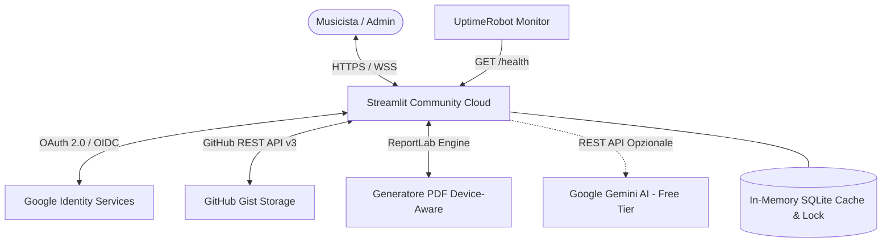
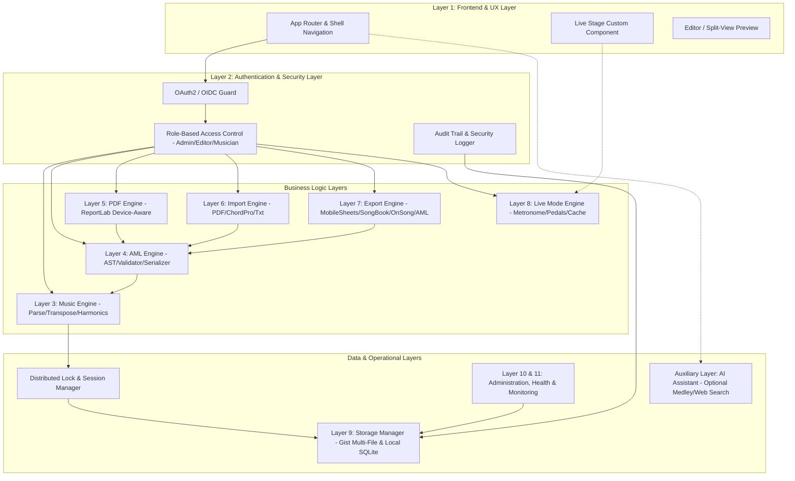
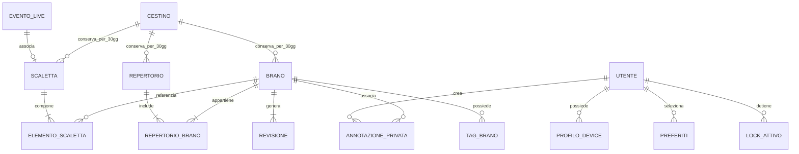
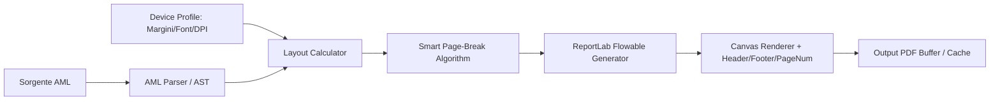
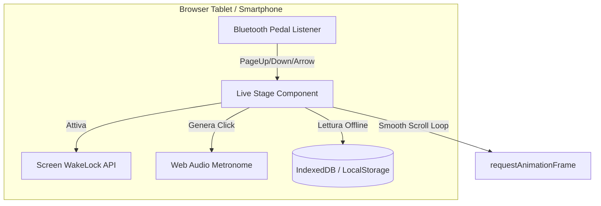
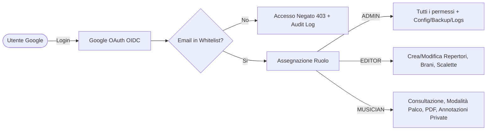
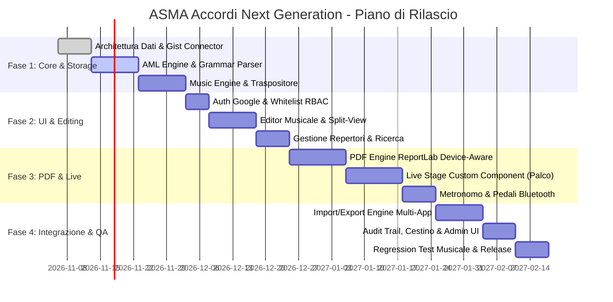

# ASMA ACCORDI NEXT GENERATION
## Architectural Blueprint & System Analysis (Fase 1)
**Versione Documento:** 1.0.0-PROPOSAL  
**Data:** 05 Novembre 2026  
**Fonte Autorevole:** SRS v1.0 (Capitoli 1 - 22)  
**Stato:** In attesa di approvazione per avvio Fase 2 (Sviluppo)

---

## 1. Analisi dei Requisiti e Conflitti Individuati

L'analisi esaustiva dei 22 capitoli della Software Requirements Specification (SRS) ha evidenziato la solidità concettuale della visione "Music First", unitamente a specifiche aree di ambiguità tecnica, colli di bottiglia architetturali e requisiti impliciti che richiedono una risoluzione formale preventiva.

### 1.1 Matrice delle Criticità e Soluzioni Architetturali

| ID | Natura | Capitolo/Sezione | Descrizione della Criticità | Impatto sul Sistema | Soluzione Architetturale Consigliata |
| :--- | :--- | :--- | :--- | :--- | :--- |
| **CRIT-01** | Conflitto Architetturale | Cap. 4.6, 7.7, 15.24 | **Concorrenza e Locking Distribuito in Streamlit + Gist**<br>La SRS richiede lock esclusivo di editing (*"Brano bloccato da Roberto"*), timeout automatico e visualizzazione utenti attivi. GitHub Gist è uno storage documentale asincrono senza primitive di lock atomico, mentre Streamlit esegue sessioni isolate con riesecuzione completa dello script (`st.rerun`). | Rischio di race condition nei salvataggi simultanei, sovrascritture involontarie e superamento del rate limit delle API GitHub Gist (5.000 req/ora per utente autenticato) se si esegue polling frequente. | Implementazione di un **Distributed Lock & State Manager in-memory** a livello di processo Streamlit (`st.cache_resource`) con timestamp heartbeat per sessione. Sincronizzazione con Gist tramite **Optimistic Concurrency Control (OCC)** basato su ETag/Git Commit SHA: se il commit remoto è avanzato rispetto alla copia locale, il lock viene invalidato e il salvataggio richiede merge manuale. |
| **CRIT-02** | Conflitto Tecnologico | Cap. 12.6 - 12.10, 12.28, 12.29 | **Vincoli UX Live Mode rispetto al Runtime Streamlit**<br>La Modalità Palco richiede: scorrimento automatico continuo a pixel variabile, navigazione pedale Bluetooth (AirTurn/PageFlip HID), Fullscreen, protezione spegnimento schermo (*Keep Screen Awake*) e funzionamento in assenza di rete (*Offline Mode*). I widget standard di Streamlit scatenano riesecuzioni Python sul server e non possono intercettare eventi tastiera globali o gestire il WakeLock API del browser. | Uno scorrimento continuo pilotato da Python genererebbe centinaia di WebSocket message al secondo, saturando la connessione e causando scatti o disconnessioni durante il live. In assenza di connessione, Streamlit mostra il banner di disconnessione bloccando lo schermo. | **Disaccoppiamento del Live Engine**: la Modalità Palco viene realizzata come **Custom Frontend Web Component** (HTML5/ES6/Canvas) isolato. La componente gestisce autonomamente nel client: `requestAnimationFrame` per lo scroll fluido, `navigator.wakeLock.request('screen')`, listener `keydown` per i codici dei pedali Bluetooth e cache client in `localStorage`/`IndexedDB` dei brani della scaletta. L'esecuzione prosegue anche a socket chiuso. |
| **CRIT-03** | Requisito Mancante / Limitazione | Cap. 15.16, 18.14 | **Endpoint REST `/health` su Streamlit Server**<br>La SRS prescrive un endpoint `/health` che restituisca un payload JSON per UptimeRobot/Pingdom. Streamlit è un server WebSocket su Tornado cheinstrada solo l'applicazione GUI e possiede internamente un proprio `/_stcore/health` non personalizzabile con i metadati richiesti. | UptimeRobot riceverebbe la pagina HTML Streamlit o codice 404 se interrogasse `/health`, impedendo la verifica fine dei sottosistemi (GitHub, Auth, PDF, AI). | Iniezione a livello applicativo di un **Tornado RequestHandler custom** all'avvio del runtime Streamlit sul percorso `/health`, oppure supporto dual-mode: (a) hook nel server Tornado sottostante per esporre `/health` puro in JSON; (b) parametro query string `?endpoint=health` che risponde immediatamente con payload JSON senza renderizzare l'interfaccia utente. |
| **CRIT-04** | Collo di Bottiglia Storage | Cap. 7.1, 10.5, 10.10, 18.9 | **Performance di Ricerca Complessa e GitHub Gist**<br>Ricerche multi-criterio ("Rock + SOL + 90 BPM", ricerca testuale nei testi AML) su centinaia di brani serializzati singolarmente su Gist comporterebbero decine di chiamate HTTP per singola query. | Latenze di ricerca > 5-10 secondi, blocco dell'interfaccia e superamento delle quote API GitHub. | **Architettura con In-Memory Index Database (SQLite / DuckDB in RAM)**: all'avvio, l'applicazione legge un file compatto `catalog_index.json` da Gist e popola un database SQLite in-memory protetto da `st.cache_resource`. Tutte le query, i filtri armonici, metrici e per tag avvengono su SQLite locale (< 2ms). La sincronizzazione verso Gist avviene solo al salvataggio (Write-Through Cache). |
| **CRIT-05** | Ambiguità Semantica | Cap. 8.4, 8.5, 8.8, 12.18 | **Notazione degli Accordi e Progressioni Armoniche in AML**<br>La SRS cita accordi italiani non standardizzati come `DO+`, `DO7+`, `LA-`, oltre a progressioni senza testo `DO LA SOL RE FA` o `C | Am | F | G`. Nella notazione italiana tradizionale `+` può significare aumentato (`aug`) o maj7 (`7+`), mentre `-` significa minore (`m`). | Possibili errori di trasposizione automatica e incoerenza tra visualizzazione a schermo e generazione PDF. | Definizione di una **Grammatica Formale Rigorosa AML** con mapping biunivoco: `DO-` / `LA-` -> Minore; `DO+` -> Triade Aumentata; `DO7+` -> Major 7; `DO7` -> Dominante 7. Le progressioni a battute usano la sintassi esplicita a measure bar `| C | Am | F | G |` con tag di sezione `{solo}` o `{intro}`. |
| **CRIT-06** | Dipendenza Implicita | Cap. 3.4, 16.4 | **Google OAuth e Dominio Whitelist**<br>L'autenticazione richiede Google OAuth con whitelist di amministrazione. L'esecuzione su Streamlit Cloud implica redirect URI dinamici o statici registrati sulla Google Cloud Console. | Se l'URL di Streamlit Cloud cambia o se il callback OAuth non è gestito correttamente all'interno dell'iframe Streamlit, l'accesso fallisce completamente. | Utilizzo del componente ufficiale `st.login` / Google OpenID Connect (OIDC) o libreria standard certificata `authlib` con gestione del token JWT verificato server-side. Whitelist degli indirizzi email memorizzata nel file di configurazione cifrato `security_whitelist.json` su Gist. |

---

## 2. Validazione Architetturale dello Stack Tecnologico

Lo stack imposto dalla SRS è stato esaminato per comprovarne la sostenibilità e definire le misure correttive necessarie:



### 2.1 Analisi Componenti e Rischi

1. **Python 3.12+**:
   - *Punti di forza*: Ecosistema ideale per la manipolazione di stringhe, parsing formale (Lark/Regex deterministiche), librerie matematico-musicali e generazione documentale (ReportLab).
   - *Mitigazione*: Utilizzo di `typing` completo, `pydantic` v2 per la validazione rigorosa dei JSON e algoritmi deterministici senza overhead.
2. **Streamlit (Frontend/Backend Unificato)**:
   - *Punti di forza*: Rapidità di rilascio, assenza di complessità DevOps, gestione reattiva dello stato con `st.session_state`.
   - *Limitazioni e Rischi*: Il modello di riesecuzione completa dello script (`rerun`) può compromettere la fluidità in contesti Real-Time e Live Stage.
   - *Misure Correttive*: Separazione rigida dell'applicazione in: **State Controllers**, **View Renderers** e **Custom JavaScript Components** per la Live Mode.
3. **Streamlit Community Cloud**:
   - *Punti di forza*: Costo zero, deploy nativo da repository GitHub, gestione integrata di `secrets.toml`.
   - *Limitazioni e Rischi*: Risorse limitate (1GB RAM per app), sleep automatico del container dopo 7 giorni di inattività, cold start di 30-40 secondi.
   - *Misure Correttive*: Polling di UptimeRobot ogni 5 minuti sull'endpoint `/health` per evitare lo spegnimento; retention minima dei PDF in RAM (pulizia automatica dei buffer temporanei).
4. **GitHub Gist come Database**:
   - *Punti di forza*: Versionamento Git intrinseco (cronologia immutabile di ogni revisione), zero costi di licenza, alta resilienza infrastrutturale di GitHub.
   - *Limitazioni e Rischi*: Rate limit API (5.000 req/ora per PAT), assenza di transazioni multi-file, latenza di rete su salvataggi sequenziali.
   - *Misure Correttive*: Architettura a **Gist Multi-File con Catalogo Compresso**. Le letture avvengono su cache locale; le scritture raggruppano i file modificati in un'unica chiamata `PATCH /gists/{gist_id}` con optimistic locking.
5. **Google Authentication**:
   - *Punti di forza*: Sicurezza enterprise, nessun onere di gestione password o hashing sul nostro database, adozione universale da parte dei musicisti.
   - *Misure Correttive*: Validazione dello stato utente prima di qualsiasi rendering; se l'utente non figura nella whitelist, la sessione viene terminata istantaneamente con codice 403 Forbidden.

---

## 3. Architettura Applicativa (11 Layer Modulari)

Il sistema adotta un'architettura rigorosamente modulare a livelli disaccoppiati, conforme al principio di singola responsabilità (*Single Responsibility Principle*):



### 3.1 Dettaglio dei Layer Applicativi

1. **Frontend & UX Layer**: Gestisce la navigazione multi-livello (Header fisso, Menu Livello 1-4, Home Dashboard, Responsive Shell per Smartphone, Tablet e Desktop).
2. **Authentication & RBAC Layer**: Intercetta ogni richiesta. Gestisce token Google OIDC, confronto whitelist, assegnazione ruoli (`ADMIN`, `EDITOR`, `MUSICIAN`) e logout per inattività.
3. **Music Engine**: Sottosistema matematico-musicale deterministico. Parsing accordi (ITA/INT), trasposizioni a semitoni (-12/+12), gestione armature di chiave (#/b), identificazione di giri armonici e calcolo compatibilità per medley.
4. **AML Engine**: Single Source of Truth del sistema. Genera l'Abstract Syntax Tree (AST) dai testi AML, valida la sintassi formale, esegue serializzazione e deserializzazione con integrità garantita.
5. **PDF Engine**: Pipeline basata su ReportLab. Riceve l'AST da AML Engine e il Device Profile selezionato, calcola spaziatura ed evita l'orfanità di accordi e sezioni (*Smart Page Break*).
6. **Import Engine**: Pipeline di ingestione multi-formato (PDF, ChordPro standard, Formato Tradizionale accordi-sopra-testo, TXT puro). Normalizza ogni sorgente convertendola in AML puro con validazione pre-salvataggio.
7. **Export Engine**: Generatore di formati interoperabili (MobileSheets, SongBookPro, OnSong, ChordPro, ZIP di repertorio, Offline Live Pack).
8. **Live Mode Engine**: Fornisce al componente frontend le configurazioni, i testi preprocessati, le annotazioni private del musicista connesso e gestisce lo stato di recupero post-crash.
9. **Storage & Persistence Layer**: Astrazione di memorizzazione a due livelli: Cache locale SQLite (letture ad alte prestazioni) e GitHub Gist Client (sincronizzazione asincrona, optimistic locking, backup e snapshot).
10. **Administration & Monitoring Layer**: Monitoraggio dell'infrastruttura (`/health`, UptimeRobot, log immutabili, gestione cestino a 30 giorni, gestione lock bloccati, gestione tag personalizzati).
11. **AI Auxiliary Layer**: Componente strettamente facoltativo (disattivabile via configurazione `AI_MODE = OFF`). Fornisce suggerimenti di sequenza medley e supporto alla documentazione. **Nessun calcolo musicale o rendering dipende da questo layer**.

---

## 4. Architettura Dati e Organizzazione Storage GitHub Gist

### 4.1 Modello Entità-Relazione (ER)



### 4.2 Struttura dei Payload JSON

Tutte le entità sono identificate tramite UUIDv4 standard e serializzate in file JSON conformi a schemi tipizzati.

#### Struttura JSON Brano (`song_{uuid}.json`):
```json
{
  "uuid": "f47ac10b-58cc-4372-a567-0e02b2c3d479",
  "title": "Hotel California",
  "artist": "Eagles",
  "author": "Don Henley, Glenn Frey, Don Felder",
  "genre": "Rock",
  "year": 1976,
  "duration_seconds": 390,
  "bpm": 74,
  "time_signature": "4/4",
  "capo": 0,
  "key_original": "Bm",
  "key_current": "Bm",
  "notation_system": "INT",
  "tags": ["live", "chitarra-12-corde", "assolo-lungo"],
  "shared_notes": "Doppio assolo finale tra Don Felder e Joe Walsh.",
  "aml_content": "{title: Hotel California}\n{artist: Eagles}\n{key: Bm}\n{tempo: 74}\n{time: 4/4}\n\n{intro}\n| Bm | F#7 | A | E | G | D | Em | F#7 |\n\n{verse}\n[Bm]On a dark desert highway, [F#7]cool wind in my hair\n[A]Warm smell of colitas, [E]rising up through the air\n\n{chorus}\n[G]Welcome to the Hotel Cali[D]fornia\nSuch a [Em]lovely place, such a [F#7]lovely face",
  "lock_status": {
    "is_locked": false,
    "locked_by": null,
    "locked_by_name": null,
    "locked_at": null,
    "session_id": null
  },
  "current_revision": 3,
  "created_at": "2026-11-01T10:00:00Z",
  "updated_at": "2026-11-05T18:30:00Z"
}
```

#### Struttura JSON Revisioni (`revisions_{song_uuid}.json`):
```json
{
  "song_uuid": "f47ac10b-58cc-4372-a567-0e02b2c3d479",
  "revisions": [
    {
      "revision_number": 1,
      "timestamp": "2026-11-01T10:00:00Z",
      "author_email": "daniele@band.org",
      "author_name": "Daniele",
      "comment": "Importazione iniziale da ChordPro",
      "aml_snapshot": "..."
    },
    {
      "revision_number": 2,
      "timestamp": "2026-11-03T15:20:00Z",
      "author_email": "roberto@band.org",
      "author_name": "Roberto",
      "comment": "Correzione accordi del ritornello",
      "aml_snapshot": "..."
    }
  ]
}
```

### 4.3 Organizzazione di GitHub Gist (Storage File Partitioning)

Per non incorrere nel limite dimensionale o in conflitti di commit concorrenti, il database Gist è partizionato logicamente su un unico Gist dedicato dell'organizzazione o sincronizzato su file nominati:

```text
GitHub Gist (Repository Database ASMA 2.0)
│
├── catalog_index.json          # Indice sintetico di tutti i brani, ID, titoli, repertori (lettura rapida)
├── repertoires.json            # Metadati di tutti i repertori e appartenenza brani
├── setlists.json               # Tutte le scalette live con sequenza brani e medley
├── live_events.json            # Eventi live pianificati e passati
├── system_config.json          # Configurazione applicativa, flag AI, impostazioni globali
├── security_whitelist.json     # Elenco utenti ammessi, ruoli e stato abilitazione
├── device_profiles.json        # Profili visualizzazione e parametri PDF device-aware
├── trash_bin.json              # Elementi cestinati con timestamp per conservazione a 30 giorni
├── audit_trail.jsonl           # Log immutabile append-only delle operazioni di sicurezza
│
├── songs/
│   ├── {uuid_1}.json           # Dati e testo AML del brano
│   └── {uuid_2}.json
│
└── revisions/
    ├── rev_{uuid_1}.json       # Storico immutabile delle revisioni per il brano
    └── rev_{uuid_2}.json
```

---

## 5. Specifica Formale del Formato AML (ASMA Markup Language)

AML (ASMA Markup Language) è la **Single Source of Truth** dell'intero sistema. Qualsiasi visualizzazione, PDF, trasposizione o esportazione discende dalla compilazione di un documento AML.

### 5.1 Grammatica Formale (EBNF)

```ebnf
aml_document      ::= ( directive | comment | section | chord_lyric_line | chord_grid_line | empty_line )* ;

directive         ::= "{" directive_name ":" directive_value "}" ;
directive_name    ::= "title" | "artist" | "author" | "key" | "tempo" | "time" | "capo" 
                    | "duration" | "c" | "comment" ;
directive_value   ::= [^\}]+ ;

section           ::= "{" section_name "}" ;
section_name      ::= "intro" | "verse" | "chorus" | "bridge" | "solo" | "outro" 
                    | "interlude" | "coda" | "medley_start" | "medley_transition" ;

custom_tag        ::= "{" tag_type ":" tag_payload "}" ;
tag_type          ::= "note" | "voice" | "guitar" | "drums" | "bass" | "keys" ;
tag_payload       ::= [^\}]+ ;

chord_lyric_line  ::= ( lyric_text | chord_token | custom_tag )+ newline ;
chord_token       ::= "[" chord_expression "]" ;

chord_grid_line   ::= "|" ( chord_expression | "/" | "%" | "|" )+ newline ;

chord_expression  ::= root_note [ accidental ] [ quality ] [ extension ] [ bass_slash ] ;
root_note         ::= "A" | "B" | "C" | "D" | "E" | "F" | "G"
                    | "DO" | "RE" | "MI" | "FA" | "SOL" | "LA" | "SI" ;
accidental        ::= "#" | "b" | "bb" | "##" ;
quality           ::= "m" | "-" | "maj" | "dim" | "aug" | "+" | "sus" ;
extension         ::= [0-9]+ | "maj7" | "7+" | "m7" | "7b5" | "m7b5" | "add9" | "sus4" | "sus2" ;
bass_slash        ::= "/" root_note [ accidental ] ;

comment           ::= "#" [^\n]* newline ;
empty_line        ::= whitespace* newline ;
```

### 5.2 Estensioni Proprietarie AML rispetto a ChordPro Standard

1. **Tag Strumentali Specifici**: `{guitar: Capo al II tasto}`, `{voice: Armonizzazione a 3 voci}`, `{drums: Ingresso cassa in 4}`.
2. **Supporto Nativo Bilingue negli Accordi**: Sintassi con notazione italiana inline (`[SOL7+]`, `[REm7]`, `[LA-/DO#]`) riconosciuta e validata dal parser senza necessità di pre-traduzione.
3. **Notazione di Griglia Armonica a Battute**: Sintassi `| DO | LAm | FA | SOL |` renderizzata graficamente sia in modalità palco che nel PDF come blocco ritmico a battute.
4. **Marcatori Medley Integrati**: Direttive `{medley_start: Nome Medley}` e `{medley_transition: Next Song, Key: G, BPM: 120}` per la concatenazione di brani fluidi senza interruzioni.

---

## 6. Progettazione del Music Engine

Il Music Engine è un componente matematico deterministico, esente al 100% da logiche AI.

### 6.1 Rappresentazione a Pitch Class (Cromatica Assoluta)

Tutte le note vengono mappate internamente su interi nell'intervallo $[0, 11]$:

$$\text{Pitch Class (PC)} \in \{0, 1, 2, 3, 4, 5, 6, 7, 8, 9, 10, 11\}$$

| PC | Nome Internazionale (#) | Nome Internazionale (b) | Nome Italiano (#) | Nome Italiano (b) |
| :---: | :---: | :---: | :---: | :---: |
| 0 | C | C | DO | DO |
| 1 | C# | Db | DO# | REb |
| 2 | D | D | RE | RE |
| 3 | D# | Eb | RE# | MIb |
| 4 | E | E | MI | MI |
| 5 | F | F | FA | FA |
| 6 | F# | Gb | FA# | SOLb |
| 7 | G | G | SOL | SOL |
| 8 | G# | Ab | SOL# | LAb |
| 9 | A | A | LA | LA |
| 10 | A# | Bb | LA# | SIb |
| 11 | B | B | SI | SI |

### 6.2 Algoritmo di Trasposizione con Regola di Armatura di Chiave

Dato un intervallo di semitoni $\Delta \in [-12, +12]$, la nuova Pitch Class è calcolata tramite aritmetica modulare:

$$\text{PC}_{\text{new}} = (\text{PC}_{\text{orig}} + \Delta) \pmod{12}$$

#### Calcolo Enharmonico Intelligente:
La selezione tra diesis (#) e bemolle (b) non è casuale:
1. Se la tonalità di destinazione appartiene al circolo delle quinte ascendenti ($G, D, A, E, B, F\sharp$), viene forzata la notazione con **diesis**.
2. Se la tonalità appartiene al circolo delle quinte discendenti ($F, B\flat, E\flat, A\flat, D\flat$), viene forzata la notazione con **bemolli**.
3. **Override Utente**: Se nel profilo o nell'editor l'utente seleziona "Preferisci bemolli" o "Preferisci diesis", l'algoritmo applica la preferenza dell'esecutore ignorando la chiave teorica.

### 6.3 Algoritmo per il Riconoscimento dei Giri Armonici e Compatibilità Medley

Per calcolare la compatibilità tra due brani consecutivi (Brano A e Brano B) per la generazione di Medley:
1. **Distanza Tonale (Circolo delle Quinte)**:
   $$D_{\text{quinte}} = \min(|Q_A - Q_B|, 12 - |Q_A - Q_B|)$$
   dove $Q$ è la posizione sul circolo delle quinte ($C=0, G=1, D=2, \dots$). Valori $D_{\text{quinte}} \le 1$ indicano compatibilità armonica immediata (stessa tonalità, tonalità relativa minore, o modulazione di quarta/quinta).
2. **Delta BPM**:
   $$\Delta_{\text{BPM}} = \frac{|\text{BPM}_A - \text{BPM}_B|}{\max(\text{BPM}_A, \text{BPM}_B)} \times 100$$
   Se $\Delta_{\text{BPM}} \le 10\%$, la transizione ritmica è realizzabile senza strappi per la batteria.

---

## 7. Progettazione del PDF Engine

### 7.1 Pipeline di Generazione ReportLab



### 7.2 Regole di Impaginazione Intelligente (Smart Page Break)

Per evitare interruzioni di lettura durante un live:
- **KeepTogether Sezionale**: Una sezione breve (es. Ritornello o Bridge di 4-8 righe) viene incapsulata in un blocco indivisibile. Se lo spazio residuo nella pagina è inferiore all'altezza del blocco, l'intero blocco viene spostato alla pagina successiva.
- **Blocco Accordo-Testo Inseparabile**: La coppia *riga accordi + riga testo* è considerata un'unità atomica. Non è mai permesso avere gli accordi sul fondo di una pagina e il testo associato in cima alla successiva.
- **Griglia Armonica**: Le battute di un giro armonico (`| C | Am | F | G |`) non vengono mai spezzate su due pagine distinte.

---

## 8. Specifiche Device Profiles

I profili dispositivo adattano dinamicamente sia il layout di esportazione PDF sia la resa della Modalità Palco:

```json
{
  "profiles": {
    "smartphone_portrait": {
      "name": "Smartphone Verticale (Android / iPhone)",
      "target_screen_width_px": 390,
      "font_family": "Helvetica-Bold",
      "font_size_lyrics_pt": 14,
      "font_size_chords_pt": 15,
      "font_color_chords": "#FFCC00",
      "font_color_lyrics": "#FFFFFF",
      "margin_top_mm": 5,
      "margin_bottom_mm": 5,
      "margin_left_mm": 4,
      "margin_right_mm": 4,
      "page_orientation": "portrait",
      "columns": 1
    },
    "tablet_stage": {
      "name": "Tablet Stage (Samsung Tab / iPad 10-11\")",
      "target_screen_width_px": 820,
      "font_family": "Helvetica",
      "font_size_lyrics_pt": 18,
      "font_size_chords_pt": 20,
      "font_color_chords": "#FFE600",
      "font_color_lyrics": "#FFFFFF",
      "margin_top_mm": 10,
      "margin_bottom_mm": 10,
      "margin_left_mm": 8,
      "margin_right_mm": 8,
      "page_orientation": "landscape",
      "columns": 2
    },
    "ipad_pro_12": {
      "name": "iPad Pro 12.9\" / A4 Live Reader",
      "target_screen_width_px": 1024,
      "font_family": "Helvetica",
      "font_size_lyrics_pt": 20,
      "font_size_chords_pt": 22,
      "font_color_chords": "#FFE600",
      "font_color_lyrics": "#FFFFFF",
      "margin_top_mm": 12,
      "margin_bottom_mm": 12,
      "margin_left_mm": 10,
      "margin_right_mm": 10,
      "page_orientation": "portrait",
      "columns": 1
    },
    "pc_a4_print": {
      "name": "Stampa Cartacea PC / A4 Standard",
      "target_screen_width_px": 1200,
      "font_family": "Courier",
      "font_size_lyrics_pt": 10,
      "font_size_chords_pt": 10.5,
      "font_color_chords": "#D32F2F",
      "font_color_lyrics": "#000000",
      "margin_top_mm": 15,
      "margin_bottom_mm": 15,
      "margin_left_mm": 12,
      "margin_right_mm": 12,
      "page_orientation": "portrait",
      "columns": 2
    }
  }
}
```

---

## 9. Progettazione della Modalità Palco (Live Stage Engine)

La Modalità Palco è progettata secondo i principi di affidabilità massima:



### 9.1 Funzionalità Chiave
1. **Controllo Scorrimento Senza Scatti**: Utilizzo dell'API standard `window.requestAnimationFrame` con velocità configurabile in pixel/secondo (da 10 px/s a 150 px/s).
2. **Supporto Nativo Pedaliere Bluetooth (HID)**: Intercettazione a livello DOM di tasti standard emessi da pedali come AirTurn DUO/BT200, PageFlip Cicada e BlueTurn:
   - `PageDown` / `ArrowDown` / `Space`: Avanzamento brano o avvio/accelerazione scorrimento.
   - `PageUp` / `ArrowUp`: Riavvolgimento brano o rallentamento/pausa scorrimento.
   - `Digit1` / `Digit2`: Brano precedente / Brano successivo nella scaletta attiva.
3. **Protezione Schermo Attivo (Keep Screen Awake)**: Invoca `navigator.wakeLock.request('screen')` per prevenire lo spegnimento o il blocco dello schermo del tablet durante l'esecuzione del concerto.
4. **Resilienza Offline (Disaster Proof)**: Al caricamento della scaletta, tutti i brani in formato renderizzato HTML e AML vengono salvati in `localStorage` del client. Se il router Wi-Fi del locale perde la connessione o Streamlit Cloud si riavvia, il musicista continua a scorrere e cambiare brano senza alcuna interruzione.
5. **Metronomo Web Audio API**: Generazione dei segnali acustici (accento sul primo quarto, battiti secondari) tramite oscillatore nativo sintetizzato lato client a latenza zero ($< 1$ ms), indipendente dal server Python.

---

## 10. Sicurezza, Privacy e Controllo degli Accessi (RBAC)



### 10.1 Gestione Sessioni e Concorrenza
- **Session Timeout**: 60 minuti di inattività determinano la scadenza del token di sessione con salvataggio preventivo dei dati modificati e rilascio automatico dei lock attivi.
- **Audit Trail Immutabile**: Tutte le operazioni di scrittura, login, logout, restore, cancellazione ed esportazione vengono registrate in formato JSONL con timestamp ISO 8601, email utente, indirizzo IP anonimizzato e User-Agent.

---

## 11. Architettura di Monitoraggio, Health Check e Telemetria

### 11.1 Risoluzione del Requisito Health Check `/health`

Per rispondere alla specifica del Cap. 15.16 e 18.14 garantendo la compatibilità con UptimeRobot:
1. **Hook RequestHandler Tornado**: Nel punto di ingresso dell'applicazione (`app.py`), il server HTTP sottostante di Streamlit viene intercettato per aggiungere la rotta non bloccante `/health`.
2. **Payload di Risposta Standard**:
```json
{
  "status": "healthy",
  "timestamp": "2026-11-05T18:47:42Z",
  "version": "2026.11.05",
  "uptime_seconds": 86420,
  "subsystems": {
    "github_gist": "ok",
    "storage_sqlite": "ok",
    "authentication": "ok",
    "pdf_engine": "ok",
    "ai_engine": "disabled_or_ok"
  }
}
```
In caso di errore su GitHub Gist o esaurimento memoria, l'endpoint restituisce HTTP `503 Service Unavailable` con indicazione esatta del componente degradato.

---

## 12. User Experience e Flussi di Navigazione

### 12.1 Sitemap Generale del Sistema

```text
[Header Fisso: 👤 Daniele (ADMIN) | Sistema: ONLINE | Battito: OK | Ver: 2026.11.05]
│
├── 🏠 1.0 Home Dashboard
│   ├── Ultime Attività & Notifiche Band
│   ├── Ultimi Brani Modificati
│   ├── Prossimo Evento Live (Accesso Rapido Palco)
│   └── Statistiche Rapide Repertorio
│
├── 📚 2.0 Gestione Repertori
│   ├── Selettore Repertorio (Working in Progress, Definitivo, Acustico, ecc.)
│   ├── Tabella Brani (Titolo, Tonalità, BPM, Autore, Tag, Stato Lock)
│   ├── Sposta Brani tra Repertori (Senza perdita storico)
│   └── Statistiche Armoniche Repertorio
│
├── 📝 3.0 Editor Brano & Split-View
│   ├── Metadati (Titolo, Artista, Key Orig/Curr, BPM, Capo, Time Signature)
│   ├── Editor Testo AML con Sintassi Evidenziata
│   ├── Barra Trasposizione Rapida (-12 / +12 semitoni, Switch ITA/INT)
│   ├── Split-View Live Preview (Anteprima Device-Aware dinamica)
│   ├── Storico Revisioni & Diff Side-by-Side
│   └── Annotazioni (Condivise Band vs. Private Personali)
│
├── 📑 4.0 Scalette Live (Setlists)
│   ├── Organizzazione Sequenza (Drag & Drop ordinamento)
│   ├── Costruttore Medley (Associazione brani e calcolo compatibilità)
│   ├── Calcolo Durata Automatica Scaletta
│   └── Pulsante Lancio: "Avvia Modalità Palco"
│
├── 🎤 5.0 Modalità Palco (Live Stage View)
│   ├── Vista Schermo Intero (Theme: Stage Dark / Stage Light / High Contrast)
│   ├── Visualizzatore Brano con Accordi ad Alto Contrasto
│   ├── Controlli Scorrimento (Start / Stop / Slider Velocità)
│   ├── Metronomo Visivo e Audio a Bassa Latenza
│   └── Barra Navigazione Scaletta ("Brano 4 di 18" - Prev/Next)
│
├── 📅 6.0 Eventi Live
│   ├── Calendario Date e Luoghi
│   ├── Associazione Scaletta Dedicata
│   └── Note Logistiche e Scheda Tecnica
│
├── 🔍 7.0 Ricerca Globale Multi-Criterio
│   ├── Filtro Testuale (Titolo, Testo, Autore)
│   └── Filtro Musicale (Tonalità, Range BPM, Metrica, Compatibilità Armonica)
│
├── 📥 8.0 Importazione
│   ├── Import PDF (Parser euristico con anteprima di correzione)
│   ├── Import ChordPro & Formato Tradizionale
│   └── Batch Import (Cartelle o file multipli)
│
├── 📤 9.0 Esportazione
│   ├── Export PDF (Device-Aware per Smartphone, Tablet, A4)
│   ├── Export MobileSheets / SongBookPro / OnSong
│   └── Generazione "Offline Live Pack" (ZIP compresso)
│
├── 🤖 10.0 Band AI (Opzionale)
│   ├── Suggeritore Sequenze Medley per Affinità Armonica
│   └── Ricerca Web Accordi e Testi Inediti
│
├── 📖 11.0 Manuale & Changelog
│   ├── Manuale Operativo Auto-Aggiornante (Web & Download PDF)
│   └── Registro Modifiche Giornaliero (Formato AAAA.MM.GG)
│
└── ⚙️ 12.0 Administration (Solo Ruolo ADMIN)
    ├── Gestione Utenti e Whitelist Google
    ├── Monitoraggio Connessioni, Storage e Log Tecnici
    ├── Gestione Cestino (Ripristino elementi eliminati entro 30gg)
    ├── Sblocco Forzato Lock Attivi
    └── Backup & Restore Completo / Selettivo
```

---

## 13. Wireframe delle Schermate Principali

### 13.1 Desktop: Split-View Editor & Preview (1920x1080 / 1440x900)

```text
+---------------------------------------------------------------------------------------------------------------+
| ASMA ACCORDI 2.0 | 👤 Daniele Rossi (Admin) | 🟢 ONLINE | 🔒 Lock: Libero | [Manual] [Changelog] [Esci]      |
+---------------------------------------------------------------------------------------------------------------+
| [1.Home] [2.Repertori] [3.Scalette] [4.Eventi] [5.Ricerca] [6.Import] [7.Export] [8.Admin]                   |
+------------------------------------------------------+--------------------------------------------------------+
| BRANO: Hotel California (Bm) - EDITING AML           | ANTEPRIMA LIVE (Device: iPad Stage Landscape)          |
| Titolo: [ Hotel California      ] Artista: [ Eagles] |--------------------------------------------------------|
| BPM: [ 74 ] Metro: [ 4/4 ] Capo: [ 0 ]              |  HOTEL CALIFORNIA - Eagles                             |
| Trasponi: [-1] [TONALITA': Bm] [+1] | Notaz: [O]ITA [•]INT |  Key: Bm | BPM: 74 | 4/4                               |
|------------------------------------------------------|--------------------------------------------------------|
| 1 | {title: Hotel California}                        |  [INTRO]                                               |
| 2 | {artist: Eagles}                                 |  | Bm      | F#7     | A       | E       |            |
| 3 | {key: Bm}                                        |  | G       | D       | Em      | F#7     |            |
| 4 |                                                  |                                                        |
| 5 | {intro}                                          |  [STROFA 1]                                            |
| 6 | | Bm | F#7 | A | E |                             |  Bm                      F#7                           |
| 7 | | G | D | Em | F#7 |                             |  On a dark desert highway, cool wind in my hair        |
| 8 |                                                  |  A                       E                             |
| 9 | {verse}                                          |  Warm smell of colitas, rising up through the air      |
| 10| [Bm]On a dark desert highway, [F#7]cool wind...  |                                                        |
| 11| [A]Warm smell of colitas, [E]rising up...        |  [RITORNELLO]                                          |
| 12|                                                  |  G                         D                           |
| 13| {chorus}                                         |  Welcome to the Hotel California                       |
| 14| [G]Welcome to the Hotel Cali[D]fornia            |  Em                        F#7                         |
| 15| Such a [Em]lovely place...                       |  Such a lovely place, such a lovely face               |
+------------------------------------------------------+--------------------------------------------------------+
| Note Condivise: [ Entrare piano con la chitarra 12 ] | [Salva Nuova Rev] [Esporta PDF] [Genera MobileSheets]  |
+---------------------------------------------------------------------------------------------------------------+
```

### 13.2 Tablet: Live Stage Mode (Orizzontale 1024x768 / 1280x800)

```text
+---------------------------------------------------------------------------------------------------------------+
| ◀ BRANO 3/16: Hotel California | TON: Bm | 74 BPM | 4/4 | METRONOMO: [● 74] | SCROLL: [⏸ PLAY] [===|===] 50px/s| ▶ |
+---------------------------------------------------------------------------------------------------------------+
| [INTRO]                                              | [STROFA 2]                                             |
| | Bm      | F#7     | A       | E       |            | Bm                          F#7                        |
| | G       | D       | Em      | F#7     |            | Her mind is Tiffany-twisted, she got the Mercedes bends|
|                                                      | A                           E                          |
| [STROFA 1]                                           | She got a lot of pretty boys that she calls friends    |
| Bm                      F#7                          |                                                        |
| On a dark desert highway, cool wind in my hair       | [RITORNELLO]                                           |
| A                       E                            | G                         D                            |
| Warm smell of colitas, rising up through the air     | Welcome to the Hotel California                        |
| G                       D                            | Em                        F#7                          |
| Up ahead in the distance, I saw a shimmering light   | Such a lovely place, such a lovely face                |
| Em                                                   |                                                        |
| My head grew heavy and my sight grew dim             | 🎸 {guitar: Assolo Don Felder su battuta 48}           |
| F#7                                                  | 🔒 Nota Privata: "Attiva Chorus prima dell'assolo"     |
| I had to stop for the night                          |                                                        |
+---------------------------------------------------------------------------------------------------------------+
| STATO: 🟢 LIVE OFFLINE-READY | PEDALE: CONNESSO (AirTurn) | BATTERIA: 92% | TEMPO SCALETTA: 18m / 1h 45m    [CHIUDI] |
+---------------------------------------------------------------------------------------------------------------+
```

### 13.3 Smartphone: Modalità Palco Verticale (390x844)

```text
+---------------------------------------+
| ◀ Brano 4/18 | G | 92 BPM | ⏸ [===] ▶ |
+---------------------------------------+
| CANZONE PER UN'AMICA - Nomadi         |
| ------------------------------------- |
| [INTRO]                               |
| | SOL | RE | DO | SOL |               |
|                                       |
| [STROFA 1]                            |
| SOL            RE                     |
| Lunga e diritta correva la strada     |
| DO             SOL                    |
| L'auto veloce correva                 |
| MIm            SIm                    |
| La dolce estate era già cominciata    |
| DO             RE                     |
| Vicino a lui sorrideva...             |
|                                       |
| [RITORNELLO]                          |
| SOL        DO          SOL            |
| Non correre, diceva bella             |
| RE                                    |
| Che c'è tempo per arrivare...         |
|                                       |
| ------------------------------------- |
| 🔒 [Solo Tu]: Terza strofa all'unisono |
+---------------------------------------+
| 🟢 LIVE OK | KeepAwake: ON | [Menu]   |
+---------------------------------------+
```

---

## 14. Design System

### 14.1 Palette Colori

| Token di Design | HEX Code | Destinazione d'Uso |
| :--- | :--- | :--- |
| `--bg-main` | `#121212` | Sfondo primario applicazione (Dark Band Theme) |
| `--bg-surface` | `#1E1E1E` | Card, container menu e pannelli laterali |
| `--text-primary` | `#F5F5F5` | Testo primario dei testi e titoli |
| `--text-secondary` | `#B0B0B0` | Metadati, durate, autori e sottotitoli |
| `--chord-stage` | `#FFD600` | Accordi in Modalità Palco (Giallo ad alto contrasto) |
| `--chord-print` | `#C62828` | Accordi per stampa PDF A4 (Rosso scuro tipografico) |
| `--section-badge` | `#0288D1` | Badge sezioni (`[INTRO]`, `[STROFA]`, `[RITORNELLO]`) |
| `--custom-tag` | `#7B1FA2` | Tag strumentali specifici (`{guitar:}`, `{voice:}`) |
| `--status-online` | `#00E676` | Indicatore stato sistema attivo / battito regolare |
| `--status-locked` | `#FF3D00` | Alert brano bloccato da altro musicista |

### 14.2 Tipografia
- **Interfaccia Utente**: `Inter`, `-apple-system`, `BlinkMacSystemFont`, `sans-serif` (leggibilità a colpo d'occhio).
- **Editor Musicale & Griglie**: `JetBrains Mono`, `Courier New`, `monospace` (allineamento perfetto caratteri-spazi tra accordi e parole).
- **Live Stage Mode**: `Roboto`, `Helvetica Neue` (grassetto puro anti-sgranamento su schermi OLED/IPS sotto illuminazione da palco).

---

## 15. Piano di Implementazione a Fasi



### 15.1 Deliverable per Fase

- **Fase 1 (Fondamenta)**: Modulo `storage_manager.py`, `aml_parser.py`, `music_engine.py` validati al 100% da unit test matematici.
- **Fase 2 (Applicazione Operativa)**: UI Streamlit multi-pagina, login Google, gestione repertori e brani con lock editing attivo.
- **Fase 3 (Ecosistema Live & PDF)**: Generazione PDF per smartphone/tablet/A4, componente Modalità Palco con scorrimento fluido e cache offline.
- **Fase 4 (Interoperabilità e Rilascio)**: Import/Export per MobileSheets e SongBookPro, manuale online autogenerato e changelog conforme `AAAA.MM.GG`.

---

## 16. Piano di Test e Quality Assurance

### 16.1 Matrice di Test Obbligatoria (Nessuna Regressione)

1. **Unit Test (Matematica Musicale)**:
   - Validazione di tutte le 12 trasposizioni cromatiche su 50 tipologie di accordi complessi (`Cmaj7`, `F#m7b5`, `Bb7sus4`, `DO7+`, `LA-`).
   - Verifica di consistenza enharmonica (es. trasposizione di $E$ a $+1$ semitono deve produrre $F$, non $E\#$).
2. **AML AST Regression Test**:
   - Compilazione, serializzazione e ri-parsing di brani con accordi sovrapposti, assenza di accordi, sole battute ritmiche e caratteri speciali. Zero perdita di token.
3. **PDF Device-Aware Automated Test**:
   - Generazione automatica di PDF di test per tutti e 4 i profili (Smartphone, Tablet, iPad, A4) e verifica programmatica dell'assenza di testi troncati (overflow detection) o accordi orfani di battuta.
4. **Live Stage Resilience Test**:
   - Simulazione di caduta della rete WebSocket: verifica che la vista del brano e lo scorrimento rimangano reattivi senza generare dialoghi di errore.
5. **Security & RBAC Test**:
   - Tentativi di accesso con email non registrate in whitelist (atteso: blocco immediato 403).
   - Tentativi di scrittura concorrente su brano con lock attivo (atteso: rifiuto del salvataggio e notifica contestuale).

---

## 17. Matrice di Tracciabilità dei Requisiti

La seguente matrice attesta la copertura esaustiva di ogni requisito espresso nella SRS, associandolo al modulo architetturale responsabile e al rispettivo impatto progettuale:

| Capitolo Sorgente | Requisito Sorgente | Modulo Coinvolto | Impatto Architetturale e Strategia di Risoluzione |
| :--- | :--- | :--- | :--- |
| **Cap. 1.4, 21.16, 22.6** | Indipendenza assoluta dall'AI per la musica | `music_engine`, `pdf_engine`, `aml_parser` | Motore musicale e parsing implementati in Python puro deterministico senza alcuna dipendenza da API OpenAI/Gemini. |
| **Cap. 3.4, 16.4, 16.5** | Accesso esclusivo Google Auth + Whitelist | `auth_manager` | Verifica token OIDC e controllo su `security_whitelist.json` su Gist prima del montaggio dei widget Streamlit. |
| **Cap. 4.6, 7.7, 15.24** | Lock Editing Brani ("Brano bloccato da...") | `lock_manager` | In-memory distributed lock con heartbeat sessione a 60 min, visualizzazione titolare del blocco e sblocco forzato da Admin. |
| **Cap. 4.7, 15.11** | Cestino con conservazione 30 giorni | `storage_manager` | Soft delete con marcatura `deleted_at` nel catalogo Gist; job di pulizia automatica dopo 30 giorni di retention. |
| **Cap. 4.10, 15.13** | Changelog automatico versione AAAA.MM.GG | `changelog_generator` | Script di compilazione release che genera una voce aggregata giornaliera al primo deploy del giorno. |
| **Cap. 4.11, 15.14** | Manuale utente auto-aggiornato (Web e PDF) | `docs_engine` | Generazione documentale dinamica markdown/PDF a partire dallo schema dei comandi e delle feature registrate. |
| **Cap. 7.4** | Identificatori universali UUIDv4 | `models` | Schema entità con chiave primaria `uuid` immutabile; i titoli sono attributi modificabili senza rompere le relazioni. |
| **Cap. 8.2 - 8.5** | Notazione Italiana e Internazionale bidirezionale | `music_engine` | Algoritmo di parsing e traduzione `ITA ↔ INT` integrato con lookup table e gestione delle alterazioni. |
| **Cap. 8.6, 17.8** | Armature automatiche (# e b) e override utente | `music_engine` | Circolo delle quinte algoritmico con flag profilo per forzatura globale diesis o bemolli. |
| **Cap. 8.8, 12.18, 13.19**| Progressioni armoniche a battute (`\| C \| Am \|`) | `aml_parser`, `pdf_engine` | Riconoscimento del costrutto `chord_grid_line` ed emissione di flowable ReportLab / blocchi HTML a griglia ritmica. |
| **Cap. 9.1 - 9.5, 13.4** | Device Profiles (Smartphone, Tablet, iPad, A4) | `device_profiles`, `pdf_engine` | Matrice di configurazione parametri (font, margini, orientamento, colonne) caricata all'inizializzazione. |
| **Cap. 11.5, 11.6** | Medley assistiti da tonalità, BPM e progressioni | `medley_engine` | Algoritmo di calcolo distanza sul circolo delle quinte e differenza percentuale di tempo per suggerire scalette ottimali. |
| **Cap. 12.6 - 12.10** | Scorrimento automatico, manuale e pedaliere BT | `live_stage_component` | Web Component HTML5/JS dedicato con `requestAnimationFrame` e listener eventi tasti HID (AirTurn/PageFlip). |
| **Cap. 12.16** | Metronomo integrato a tempo e volume | `live_stage_component` | Web Audio API lato client per sintesi audio del click a latenza zero ($< 1$ ms). |
| **Cap. 12.28, 18.12** | Cache Offline della Modalità Palco | `live_stage_component` | Persistenza in `localStorage`/`IndexedDB` client-side di tutti i brani della scaletta per esecuzione senza rete. |
| **Cap. 12.29** | Keep Screen Awake anti-spegnimento | `live_stage_component` | Chiamata automatica a `navigator.wakeLock.request('screen')` durante la permanenza nella Live Stage Mode. |
| **Cap. 13.21, 13.22** | Smart Page Break e allineamento accordi | `pdf_engine` | Calcolo ingombro verticale dei blocchi e incapsulamento in flowable indivisibili per prevenire tagli di sezioni e accordi. |
| **Cap. 14.4, 14.5, 14.6** | Import PDF, ChordPro e Tradizionale | `import_engine` | Parser a cascata (estrazione testo da PDF, parsing accordi sopra testo, regex ChordPro) con normalizzazione in AML. |
| **Cap. 14.23 - 14.25** | Export MobileSheets, SongBookPro, OnSong | `export_engine` | Compilatori dedicati da AML AST verso ChordPro esteso con tag compatibili con ciascuna applicazione di terze parti. |
| **Cap. 15.16, 18.14** | Endpoint di monitoraggio `/health` | `monitoring_service` | Hook request handler nel server Tornado di Streamlit che risponde con lo stato di salute dei sottosistemi a UptimeRobot. |
| **Cap. 15.19, 16.16** | Audit Trail immutabile | `audit_logger` | File append-only `audit_trail.jsonl` con tracciamento di login, modifiche, eliminazioni e restore. |
| **Cap. 18.9, 22.8** | Storage su GitHub Gist a costo zero | `gist_storage_adapter` | Connettore REST API GitHub con autenticazione PAT, ottimizzato tramite catalogo SQLite in-memory di lettura. |
| **Cap. 18.13** | Prevenzione Sleep Mode Streamlit Cloud | `deployment_config` | Monitoraggio continuo ogni 5 min da UptimeRobot sull'endpoint `/health`. |
| **Cap. 21.2** | Compatibilità retroattiva e migrazione | `data_migrator` | Schema versioning nei JSON (`schema_version: 2`) e parser con tolleranza per campi assenti nei vecchi formati. |

---

## 18. Proposte di Miglioramento Architetturale Non Requisito

A completamento dell'analisi della SRS, si sottopongono all'approvazione le seguenti 3 ottimizzazioni architetturali ad alto valore aggiunto, pienamente compatibili con i vincoli imposti:

1. **Audio Pitch Shifter di Esempio (Local Audio Preview)**:
   - *Proposta*: Consentire l'aggancio di un link audio o file MP3 di prova nell'editor brano, con applicazione della trasposizione dell'intonazione (Web Audio API Pitch Shifting) per permettere ai cantanti di provare la tonalità direttamente dall'applicazione prima di salvarla.
2. **PWA Manifest & Service Worker per Installazione Icona Palco**:
   - *Proposta*: Iniettare un Web App Manifest (`manifest.json`) per consentire ai tablet Android e agli iPad di "Aggiungere alla schermata Home" l'app come applicazione a pieno schermo standalone, eliminando definitivamente le barre degli indirizzi del browser Safari/Chrome durante i live.
3. **QR Code per Condivisione Rapida Scaletta agli Ospiti**:
   - *Proposta*: Nella vista Evento Live o Scaletta, generazione automatica di un QR Code visualizzabile su schermo o stampabile, che permette a musicisti ospiti o fonici di aprire immediatamente la scaletta in modalità consultazione/sola lettura senza necessità di login preventivo.
